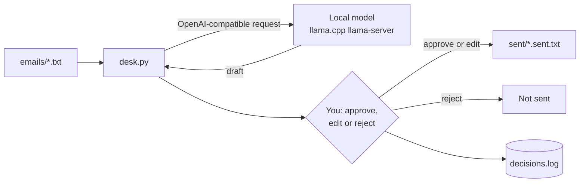

# northline-support-desk

A support inbox where a local AI model drafts every reply and a person approves, edits or rejects it before anything counts as sent.

It's a small, readable demo of the human-approval pattern for a fictional candle shop, Ember & Wick. One Python file, standard library only, MIT licensed.

## What it does

- **Drafts replies with a model on your own machine.** It sends each email to a local llama.cpp server (or any OpenAI-compatible chat endpoint). No cloud API is needed.
- **Stops for a human every time.** For each draft you choose approve, edit then approve, or reject. Nothing is marked sent without that choice.
- **Logs every decision.** Each choice lands in `decisions.log` as one JSON line with the time, the email, the action, the model and your note.
- **Keeps the model honest by design.** The prompt tells the model to leave unknown details such as order dates or policies to a human instead of inventing them.

## How it works



"Sending" is simulated: approved replies are written to `sent/`, and no real email leaves your machine.

## Quickstart

You need Python 3, [llama.cpp](https://github.com/ggml-org/llama.cpp)'s `llama-server`, and a Qwen2.5-7B-Instruct Q4_K_M GGUF model file. That model fits on a single consumer GPU.

1. **Get the code.**

   ```bash
   git clone https://github.com/meowsigma/northline-support-desk && cd northline-support-desk
   ```

2. **Start the local model** in a second terminal.

   ```bash
   llama-server -m Qwen2.5-7B-Instruct-Q4_K_M.gguf --port 18091 -c 4096
   ```

3. **Review the inbox.** For each of the 5 demo emails, read the draft and press `a` to approve, `e` to edit or `r` to reject.

   ```bash
   python3 desk.py review
   ```

To only write drafts to `drafts/` without reviewing, run `python3 desk.py draft`.

## Example output

This run on 2026-11-28 used a stand-in endpoint that always returns the same short reply, so it shows the review gate and the log, not the model's writing. With `llama-server` running, the draft is the model's own reply to each email.

The first email in `python3 desk.py review`, approved with `a`:

```text
>>> drafting reply for 01_late_order.txt ...
    drafted in 0.0s by stand-in endpoint (fixed reply)

========================================================================
INCOMING  [01_late_order.txt]
------------------------------------------------------------------------
From: dana.k@example.com
Subject: My order hasn't moved in 8 days

Hi Ember & Wick,

I ordered two "Smoke & Cedar" 8oz jars on the 12th (order EW-10294, totally made up) and the confirmation email still says "preparing". It's been over a week and I was hoping to burn them for a dinner party this Saturday.

Can you tell me what's going on?

Thanks,
Dana
------------------------------------------------------------------------
MODEL DRAFT
------------------------------------------------------------------------
Hi there, thanks for writing in. A human on the team will confirm the details. Sam @ Ember & Wick
------------------------------------------------------------------------
[a]pprove & send  [e]dit then send  [r]eject  > a
    simulated send -> /tmp/northline-support-desk/sent/01_late_order.sent.txt
```

`decisions.log` after reviewing all 5 emails (2 approved, 1 edited, 2 rejected with a note):

```json
{"ts": "2026-11-28T05:43:12", "email": "01_late_order.txt", "action": "approved->sent", "model": "stand-in endpoint (fixed reply)", "note": "", "chars": 97}
{"ts": "2026-11-28T05:43:12", "email": "02_wrong_scent.txt", "action": "edited->sent", "model": "stand-in endpoint (fixed reply)", "note": "", "chars": 134}
{"ts": "2026-11-28T05:43:12", "email": "03_damaged_shipping.txt", "action": "rejected", "model": "stand-in endpoint (fixed reply)", "note": "Ask for photos of the damage first", "chars": 97}
{"ts": "2026-11-28T05:43:12", "email": "04_wholesale_inquiry.txt", "action": "rejected", "model": "stand-in endpoint (fixed reply)", "note": "Wholesale pricing is the owner's call", "chars": 97}
{"ts": "2026-11-28T05:43:12", "email": "05_refund_request.txt", "action": "approved->sent", "model": "stand-in endpoint (fixed reply)", "note": "", "chars": 97}
```

## The 5 demo emails

All customers, orders and the shop are made up, and the addresses use `example.com`:

| File | Situation |
| --- | --- |
| `01_late_order.txt` | Order still shows "preparing" after 8 days |
| `02_wrong_scent.txt` | Wrong scent in the box |
| `03_damaged_shipping.txt` | Arrived smashed |
| `04_wholesale_inquiry.txt` | A boutique hotel asking about wholesale |
| `05_refund_request.txt` | Refund for a candle that burned out after 3 burns |

Drop your own `.txt` files into `emails/` to try other cases.

## Settings

| Variable | Default | What it sets |
| --- | --- | --- |
| `DESK_MODEL_URL` | `http://127.0.0.1:18091/v1/chat/completions` | Any OpenAI-compatible chat endpoint |
| `DESK_MODEL_NAME` | `Qwen2.5-7B-Instruct-Q4_K_M (local llama.cpp)` | The model name sent with each request and written to the log. Set it to the name your endpoint expects. |

## License

[MIT](LICENSE)
